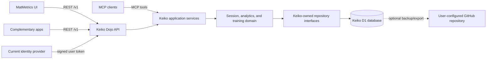

# Keiko Dojo Implementation Plan

**Status:** Proposed roadmap

**MatMetrics baseline reviewed:** `CyanAutomation/matmetrics` at commit `0f8fd5d`

## Goal

Make Keiko Dojo the reusable backend for MatMetrics and complementary apps.
Keiko Dojo will own training-domain rules, authenticated data access, D1-backed
session operations, and shared analytics. MatMetrics will remain the visual
product: it will render the dashboard and forms, manage client interactions,
and call Keiko Dojo through its API. MCP tools will call the same application
services as the REST API so they cannot drift into a second implementation of
the rules.

The first vertical slice should move session records end to end. It is the
clearest shared domain, and MatMetrics already has a Go model, validation,
Markdown storage, GitHub integration, and API handlers that can inform the
service design.

## What exists today

The Keiko Dojo repository has no runtime implementation yet. The MatMetrics
repository already has several backend pieces, but they are split across its
frontend and Go code:

| Area | Current MatMetrics implementation | What Keiko Dojo should do |
| --- | --- | --- |
| Session contract | TypeScript and Go session models; shared Markdown shape | Own a versioned domain contract and canonical validation |
| Session API | Next.js routes plus Go serverless handlers | Provide one authenticated session API used by MatMetrics and other clients |
| Session persistence | User GitHub Markdown repositories, local Markdown fallback, browser cache and offline queue | Make Keiko-owned D1 authoritative; make GitHub an optional user-configured backup/export target |
| Authorization | Next.js resolves a user's allowed GitHub repository before proxying | Enforce account and resource authorization inside Keiko on every request |
| Dashboard metrics | Derived in the MatMetrics client | Move reusable aggregates to domain/read-model services; leave chart rendering in MatMetrics |
| Authentication | Better Auth Worker issues signed tokens | Keep sign-in in the current identity provider initially; have Keiko validate tokens and scopes |
| AI features | Next.js handlers call Cloudflare AI Gateway and JEV/OpenRouter | Move provider calls and product rules after API, data, and privacy contracts are agreed |
| GitHub tools | Go code supports session operations, sync, validation, and Log Doctor | Keep as an integration adapter behind Keiko's authorization boundary |

Useful source references from the reviewed MatMetrics baseline include
`docs/go-contract.md`, `internal/model/session.go`,
`internal/sessionapi/validation.go`, `internal/storage/storage.go`,
`internal/httpapi/authentication.go`, `api/go/sessions/`,
`src/lib/session-validation.ts`, `src/lib/session-storage.ts`,
`src/lib/dashboard-overview-stats.ts`, and
`docs/cloudflare-d1-migration.md`.

One boundary needs special care during extraction: MatMetrics' Next.js routes
check which GitHub repository belongs to the signed-in user before calling the
Go endpoints. The Go session handlers authenticate the request but also accept
`owner` and `repo` from that request. Keiko Dojo must not rely on MatMetrics to
perform this authorization; the service must resolve the account's permitted
data source itself and ignore untrusted client-supplied ownership claims.

## Target shape

The REST API is the first integration contract. MCP is an additional transport
over the same application services, not a separate business-logic layer.
Keiko Dojo should be deployable and observable independently of the MatMetrics
web application.

## Recommended ownership

**Keiko Dojo owns:**

- Session types, validation, normalization, IDs, revisions, and CRUD behavior.
- User-to-data ownership checks and integration credentials.
- D1-backed session storage, schema migrations, import/export, and reusable
  analytics.
- Optional, user-configured GitHub backups and explicit restore/import flows.
- Shared AI operations once provider use, data handling, and policy are defined.
- Versioned REST and MCP contracts, service health, and operational logs.

**MatMetrics owns:**

- Pages, forms, charts, design, and presentation formatting.
- Client-side loading, optimistic UI, and temporary cache/offline behavior.
- Guest preview data, unless it later becomes a Keiko-hosted feature.
- The initial sign-in experience and Better Auth integration.

MatMetrics may keep a thin server-side adapter during the transition. It should
not keep an independent copy of session validation, persistence decisions, or
analytics rules after the corresponding Keiko endpoint is in use.

## Delivery phases

### 0. Set the contract and deployment decisions

Before writing persistence or production auth code, record short architecture
decisions for:

1. **Runtime and database:** the recommended first runtime is a Cloudflare
   Worker written in TypeScript with a native D1 binding. D1 application
   queries are made through [Worker bindings](https://developers.cloudflare.com/d1/worker-api/d1-database/);
   Cloudflare describes its [D1 REST API](https://developers.cloudflare.com/d1/tutorials/build-an-api-to-access-d1/)
   as suited to administrative use. A separate Go runtime would need a
   Keiko-owned Worker data API in front of D1, adding another service hop.
   Keep Keiko's Worker and D1 database separate from MatMetrics' existing
   `matmetrics-data` Worker and database so Keiko owns its schema and deploys.
2. **Identity:** retain Better Auth initially and use short-lived access tokens
   with a Keiko-specific audience and explicit scopes. Prefer having the
   identity provider issue these tokens directly with a maximum five-minute
   lifetime. If Keiko adds a token exchange endpoint (`POST /oauth/token`), it
   must be server-side: verify the upstream signature, issuer, audience, `nbf`,
   and `exp`, then check the upstream session's active/revoked state through a
   Better Auth session lookup or token-introspection mechanism before issuing a
   Keiko token. An exchanged token expires at the earlier of the
   upstream expiry or five minutes after issuance. Keiko validates signature,
   issuer, audience, `nbf`, `exp`, subject, and scopes on every request. Define
   whether revocation is checked online on each request or has a bounded delay
   no longer than the five-minute token lifetime. Never treat a valid signature
   alone as proof that the source session is still active, and never trust an
   `X-User-Id` supplied without a verified signature.
3. **D1 tenancy and schema:** use a D1 database per environment, with every
   user-owned record scoped by the verified stable user ID. Define indexes,
   record revisions, migrations, and recovery procedures before production
   data is imported.
4. **GitHub backup access:** define how a user connects one repository and
   grants the minimum required contents access. Keep credentials or installation
   references server-side and support revocation.
5. **API contract:** publish OpenAPI from Keiko and freeze the initial session
   shape, error format, pagination, and concurrency behavior.
6. **AI data handling:** before building or enabling any Keiko endpoint that
   sends user data to an external AI provider, document and review its field
   allowlist, purpose, provider retention/training policy, user consent, and
   logging behavior. This gate applies to development and staging as well as
   production.

For the first contract, preserve the MatMetrics session fields and categories
(`id`, `date`, `description`, `techniques`, `effort`, `category`, `notes`,
`duration`, and `videoUrl`) and its established validation semantics. Add
Keiko-specific metadata such as ownership and record revision outside the
user-editable session payload.

**Exit condition:** these choices are documented, and both projects can agree
on a generated or fixture-backed contract without hand-maintaining two subtly
different validators.

### 1. Build the Keiko Worker and session API

Create an independently deployable Cloudflare Worker with configuration,
structured logging, health/readiness endpoints, and environment-specific D1
bindings. Keep session validation and application services independent of the
Worker request handlers and the D1 query adapter. The existing MatMetrics Go
CLI and utilities can remain during the transition; they should not remain a
second production session API.

Implement the first endpoints under `/v1`:

- `GET /v1/sessions` with stable ordering, filters, and pagination.
- `POST /v1/sessions`.
- `GET`, `PUT`, and `DELETE /v1/sessions/{id}`.
- `GET /v1/analytics/summary` for the dashboard's core counts and effort
  summaries after the session API shape is settled.

Use a `SessionRepository` interface keyed by the verified user identity, with
D1 as the production implementation from the first vertical slice. Use
parameterized queries and enforce user ownership in every read and mutation.
Keep GitHub access in a separate backup adapter; session reads and writes must
not depend on GitHub being reachable or configured.

Represent concurrent writes with an ETag or explicit record version and
`If-Match`. Use consistent JSON errors and request IDs. Keep API keys and
provider credentials out of browser code.

**Exit condition:** a staging MatMetrics account can list, create, retrieve,
update, and delete its sessions through Keiko; a second test client can call
the same public contract; requests cannot read or mutate another account's
records.

### 2. Import existing records and switch MatMetrics to Keiko

Add a MatMetrics API client configured with a Keiko base URL. Keep the current
Next.js endpoints as a thin compatibility layer at first so the UI routes do
not all need to change in the same release. Remove their duplicated validation
and storage branches as each operation is delegated to Keiko. Keep guest mode
and its offline queue local.

Implement an idempotent importer from each account's current Markdown
repository, including [CyanAutomation/keikotracker](https://github.com/CyanAutomation/keikotracker),
into Keiko D1. For each account:

1. Run a dry import and report parse errors, duplicate IDs, and record counts.
2. Compare imported IDs and normalized payloads with the source.
3. Pilot a small set of accounts with a per-account source-of-truth switch.
4. After cutover, serve all reads and writes from D1. Do not dual-write session
   mutations to D1 and GitHub.
5. Keep the original GitHub copy available through a stated rollback window.
   Afterward, let users connect a GitHub repository as an optional backup
   target; provide Markdown export whether or not they enable backups.

**Exit condition:** MatMetrics account data is served from Keiko for the pilot,
re-imports are safe, D1 is authoritative, and rollback does not lose writes
made after cutover.

### 3. Add optional GitHub backups and restore

GitHub becomes a secondary copy, never the live read/write store. Implement a
user-configured backup target with a clear status and last-success timestamp.
Backups should run on demand and through a scheduled/background job, preserve
the existing Markdown format where practical, and be idempotent. A GitHub
outage or revoked permission must not block D1 session operations.

Store the target repository, backup path, granted access reference, and backup
run status as Keiko-owned integration data; keep access tokens out of session
records. Write only under the configured backup path. Track enough version or
snapshot metadata to explain which D1 state each GitHub backup represents.

Make restore an explicit, auditable operation: preview the repository contents,
show conflicts and record counts, then require an intentional restore into D1.
Define how backup snapshots are identified so restore does not silently
overwrite newer D1 data. Record backup failures and retry them without
replaying a user session mutation.

### 4. Move shared business logic

Move domain rules in slices, with parity checks against the current MatMetrics
behavior:

1. Session validation and normalization, using the existing shared validation
   fixtures as the starting point.
2. Dashboard aggregates and date/category/effort calculations, returned as
   analytics read models for MatMetrics charts.
3. Technique catalog and recommendation rules, if those rules should apply to
   all Keiko clients.
4. JEV assessments, description transforms, and AI technique suggestions
   behind provider adapters only after the AI data-handling decision in Phase 0
   is approved. Before any provider call is built or enabled in any
   environment, document each endpoint's field allowlist and purpose, provider
   retention/training policy, user-facing consent, limits, sanitized logging,
   and failure behavior. Keep the MatMetrics UI responsible for obtaining
   consent and showing provider handoffs. No provider call may be enabled in
   staging while this gate is incomplete.
5. GitHub sync, health checks, and Log Doctor operations after repository
   authorization and job ownership are centralized.

Each slice should have one Keiko implementation and a MatMetrics client
adapter. MatMetrics can keep display formatting and form-level convenience
checks, but Keiko's response is authoritative for acceptance and persistence.

### 5. Add MCP as a second client interface

Once the REST contract and authorization model are stable, add an MCP server
that calls the same application services. Start with read-only tools such as
`list_sessions`, `get_session`, and `get_training_summary`. Add write tools only
with delegated user authorization, explicit scopes, validation errors, and
idempotency protection. Tool descriptions should point to the same concepts
and limits as OpenAPI.

**Exit condition:** an MCP client and a REST client see the same account scope,
records, analytics, and validation behavior.

### 6. Expand to other apps

Document client registration and token issuance for complementary apps. Start
with user-delegated access tokens scoped to Keiko (`sessions:read`,
`sessions:write`, and narrowly defined analytics or integration scopes). Add
service-to-service credentials only for non-user operations. Publish API
examples, rate limits, pagination rules, deprecation policy, and a sandbox
account or test environment.

## First implementation milestone

The first code milestone should be one reviewable vertical slice in this
repository:

1. Add the TypeScript Worker project, Wrangler configuration, and separate
   local/staging/production D1 bindings.
2. Add the canonical session contract, OpenAPI document, validation, and first
   D1 schema migration.
3. Add token verification and user-scope authorization before exposing data,
   including expiry, audience, scope, revocation behavior, and the five-minute
   Keiko token lifetime cap.
4. Add user-scoped `GET /v1/sessions` against local D1, then session mutations
   with per-user ownership and record revisions.
5. Add CI checks for contract parity, migrations, and Worker type safety.

Then implement the GitHub import and backup adapters. This keeps domain,
authorization, and D1 ownership reviewable before external repository access
or AI-provider work begins.

## Cross-project completion criteria

- Keiko Dojo can be built, run, configured, and deployed without the MatMetrics
  Next.js process, with D1 bound to the Keiko Worker in each environment.
- MatMetrics' account-backed session reads and writes use the Keiko API; it no
  longer makes business or persistence decisions for those requests.
- Every record operation is scoped to a verified user or explicitly granted
  application scope inside Keiko.
- OpenAPI, shared fixtures, and migration notes make contract changes visible
  to MatMetrics and other clients.
- D1 is the authoritative session store. Existing Markdown records can be
  imported and exported without silent data loss, and per-account cutover has a
  tested rollback path.
- A user's GitHub backup can be enabled, observed, revoked, and restored
  without making ordinary session operations depend on GitHub availability.
- No live AI provider call is enabled in any environment until its field
  allowlist, retention/training terms, consent, logging, and failure rules are
  documented and approved.
- MCP and REST use the same service methods, authorization checks, and record
  versions.
- Health, request IDs, safe structured errors, rate limits, and backup/restore
  procedures are documented before production use.
